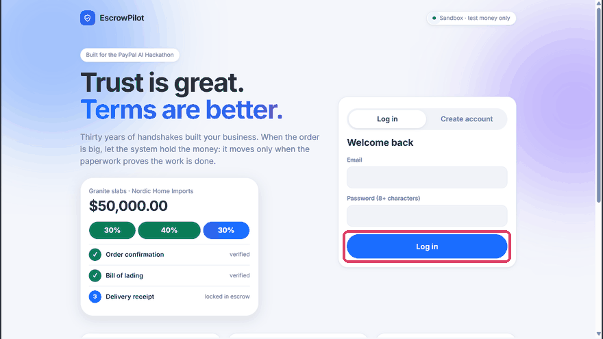
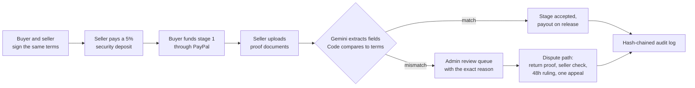
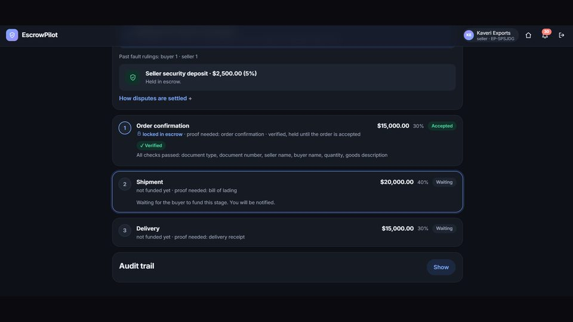
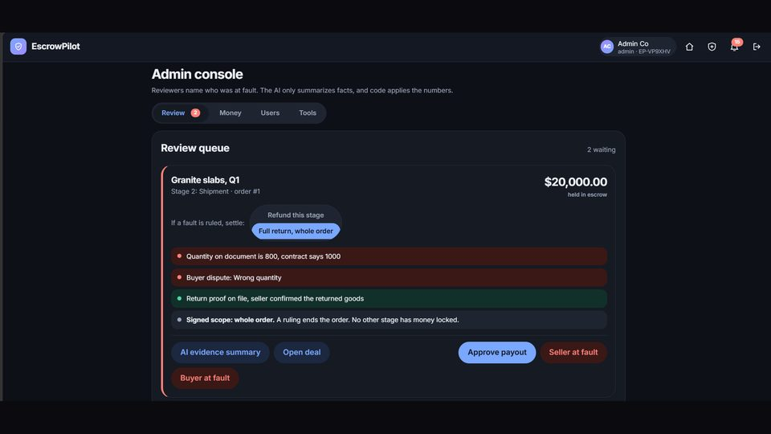
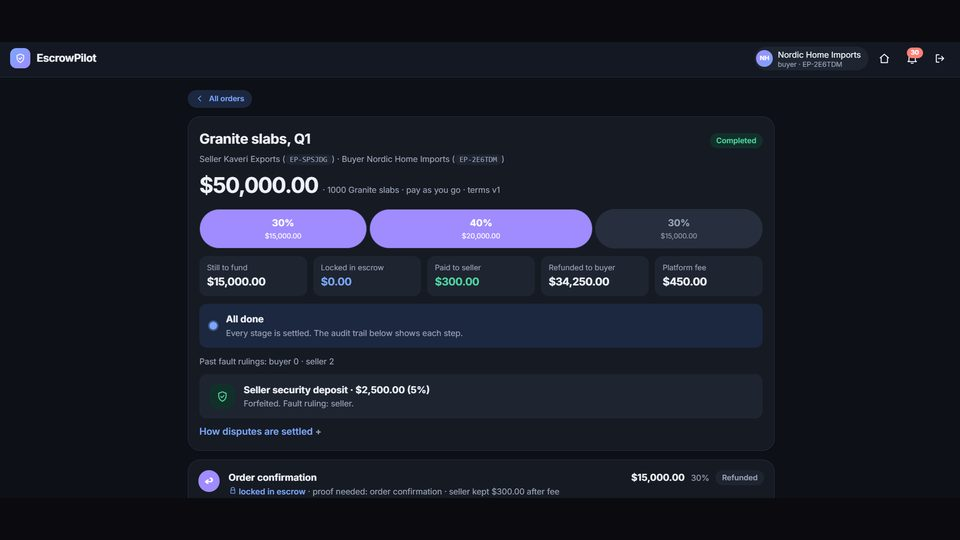
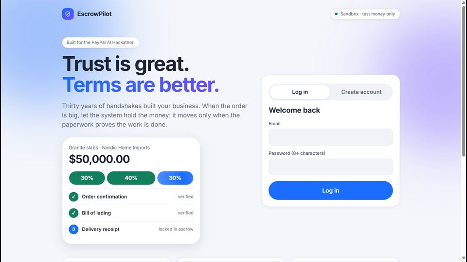

<p align="center">
  
</p>

<p align="center">
  <a href="https://escrowpilot-app.vercel.app"></a>
  <a href="https://youtu.be/W4YZG8KVnHg"></a>
  
  
  
</p>

> **Sandbox demo. Test money only.** Everything runs on PayPal sandbox and every sample document is fake. This public repo uses a mock payment provider by default and the PayPal sandbox when you add keys. A licensed partner would hold real funds in production.

## The problem

Exporters trade on relationships that last decades. When an order is large, trust is the only protection, and it fails more often than anyone admits: a buyer pays late, short, or not at all, or the goods come back and nobody agreed who pays. Letters of credit fix this but are slow and expensive, so small traders skip them.

**EscrowPilot gives them escrow with the ease of a handshake.** Both sides sign the exact terms in advance, money is held per stage, and paperwork decides what is released.

## See it in motion

<p align="center">
  
</p>
<p align="center"><sub>Click-through of the real app. The red box shows what is clicked next. Watch the <a href="https://youtu.be/W4YZG8KVnHg">full 2:20 video</a>.</sub></p>

## How it works



**The AI never decides who gets paid. A deterministic rules engine does.** Gemini only reads documents and extracts fields. Documents are treated as untrusted text and the model has no tools.

## Highlights

| | |
|---|---|
| **Signed terms** | Milestones, inspection window and failure terms are agreed first. Any edit voids both signatures. |
| **Pay as you go** | The buyer funds each stage just before it starts. Nobody ties up the whole price. |
| **Two-sided stake** | The seller puts down a refundable 5% deposit first, so both sides have something to lose. |
| **Document check** | PDF, photo or text. Gemini extracts fields, plain code compares them to the contract and to earlier stages. |
| **Fair disputes** | Return proof, the seller's returned-goods check, a 48-hour wait, then one appeal to a different reviewer. |
| **Duplicate guard** | A file reused in another open order is flagged. |
| **No double pay** | Every payout carries an idempotency key. |
| **Tamper-evident log** | Every step is written to a hash-chained audit log. |

<p align="center">
  
  
</p>
<p align="center">
  
  
</p>

## Money rules

| Case | What happens |
|---|---|
| Good order | Seller is paid minus a 2% fee, and the deposit is returned. |
| Seller at fault | Buyer is refunded in full plus 2% of the order from the deposit. The platform keeps 3%. The deposit is forfeited. |
| Buyer at fault, goods returned | Every held stage is refunded minus 5%. The seller gets 2%, the platform 3%, and the deposit is returned. |
| Buyer at fault, keeps the goods | Seller is paid in full minus the fee. |

No refund moves until the seller has checked the returned goods (5 days; no answer counts as confirmed). The seller deposit is a signed term, 0 to 20%, default 5%.

**Fairness checks.** A fault ruling waits 48 hours (`COOLING_OFF_HOURS`). Either side can appeal once, and a different admin decides (list several in `ADMIN_EMAIL`, comma separated). New documents are cross-checked against earlier stages (quantity, dates). The reviewer gets a facts-only AI summary that never recommends a ruling.

## Tech stack

| Layer | Tools |
|---|---|
| Backend | Python, FastAPI, SQLAlchemy, PostgreSQL (Neon) or SQLite locally |
| Frontend | React, Vite |
| Payments | PayPal Orders and Payouts APIs (sandbox), behind a small funds-holder interface |
| AI | Gemini free tier for document field extraction, with an offline fallback |
| Security | bcrypt, JWT, role checks on every route, integer cents, hash-chained audit log |
| Hosting | Vercel (frontend), Render (API), Neon (database) |
| Tests | 60 automated tests (pytest) |

## Try it

1. Open **https://escrowpilot-app.vercel.app**. The free server can take about 30 seconds to wake on the first request.
2. Sign in as a buyer and as a seller, in two separate browsers. Demo credentials are given in the Devpost testing instructions.
3. Create an order, sign it as both, pay the deposit and a stage with the PayPal sandbox payer.
4. Upload the sample documents from [`sample_docs/`](sample_docs). Try the wrong-quantity bill of lading to see a mismatch flagged.
5. Dispute a stage, upload the return receipt, and watch the signed rules play out.

## Run locally (no keys needed)

```bash
cd backend
python -m venv .venv && source .venv/bin/activate
pip install -r requirements.txt
cp .env.example .env        # set SECRET_KEY and ADMIN_EMAIL
set -a; source .env; set +a
uvicorn app.main:app --reload
```

API docs at http://localhost:8000/docs. Register with the `ADMIN_EMAIL` address to get the admin role. Run the tests with `cd backend && python -m pytest -q`.

```bash
cd frontend
npm install
cp .env.example .env     # VITE_API_URL=http://localhost:8000
npm run dev              # http://localhost:5173
```

Walk-through: register an admin (the `ADMIN_EMAIL` address), a seller and a buyer. Verify both in the Admin screen, connect them by id, create an order, sign as both, pay, load the sample documents, then dispute and return to see the signed refund.

## Configuration

- **Gemini (free tier):** get a key at Google AI Studio, then set `AI_PROVIDER=gemini` and `GEMINI_API_KEY=...`. If Gemini fails, it falls back to the offline rules. *Verified live with `scripts/live_smoke.py`.*
- **PayPal sandbox:** create a sandbox app at developer.paypal.com, then set `PAYPAL_MODE=sandbox`, `PAYPAL_CLIENT_ID`, `PAYPAL_CLIENT_SECRET` and a webhook id pointing at `/webhooks/paypal`. Payouts must be enabled for the sandbox app, and seller accounts need a `paypal_email` that is a sandbox account. *Verified live (funding, capture, payout, webhook): 11 of 11 checks passed.*
- **Documents:** PDF, PNG, JPEG or text, 5 MB max. PDFs with text are read directly; scans and photos need Gemini.
- **Notifications:** in-app bell; set `SMTP_*` to also send email.
- **Deploy:** see [`DEPLOY.md`](DEPLOY.md). API on Render, frontend on Vercel, Postgres on Neon (set `DATABASE_URL`).

## Security notes

- Secrets only from environment variables. `.env` is git-ignored.
- Passwords hashed with bcrypt, JWT sessions, users only see their own deals.
- Money is stored as integer cents. Uploads are size-limited. Documents are untrusted text to the AI prompts.
- Demo shortcuts: tables auto-created, KYC is a button, no rate limiting. Production replaces these.

## What is next

Pilots with real exporters in shadow mode (their orders and terms in EscrowPilot while money moves as today), then funded escrow through a licensed partner, then financing from partner lenders against verified, funded orders.

## Licence

[MIT](LICENSE)
